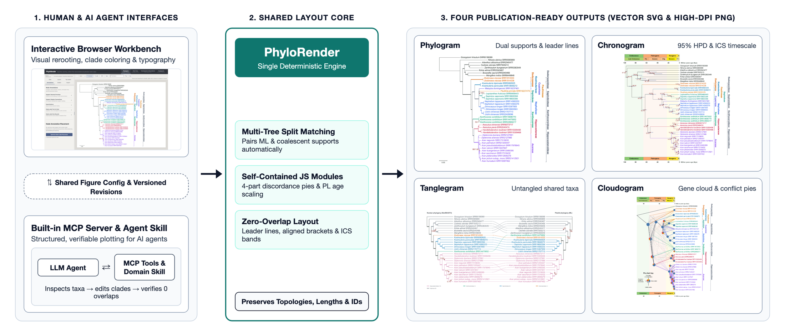
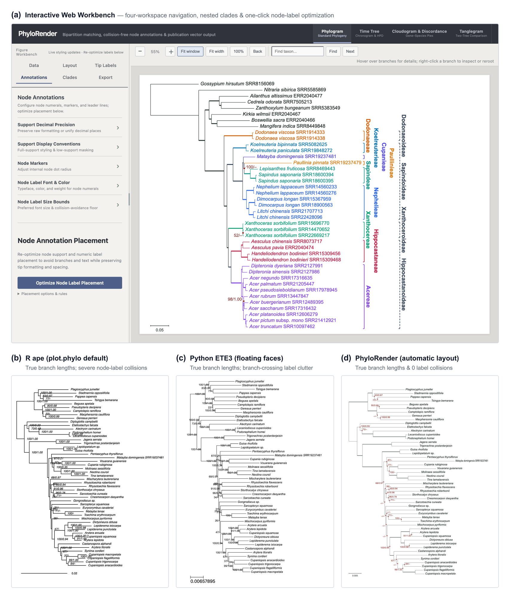
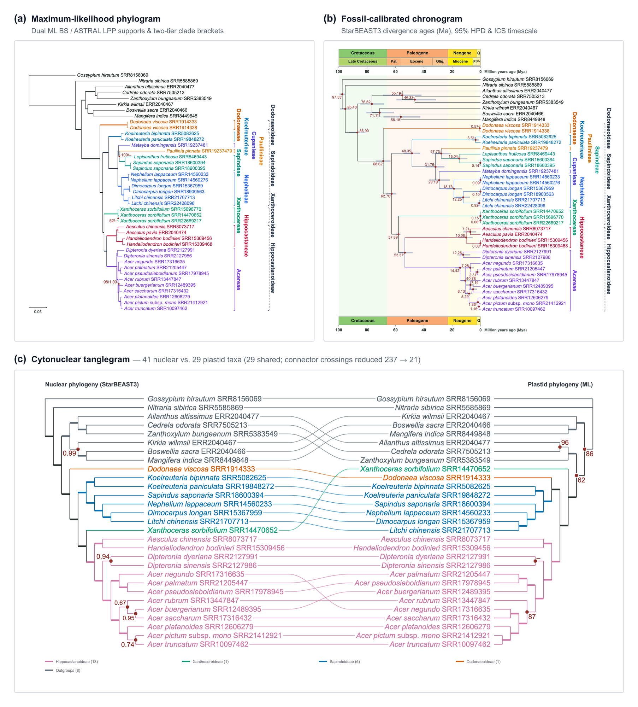
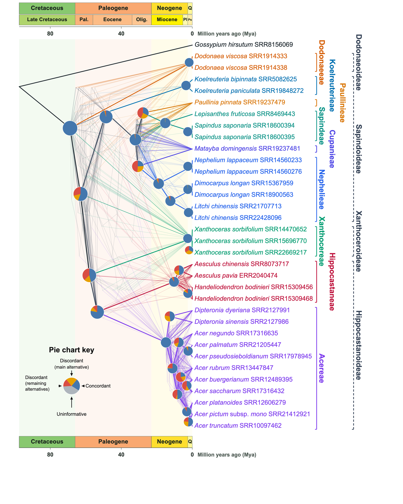
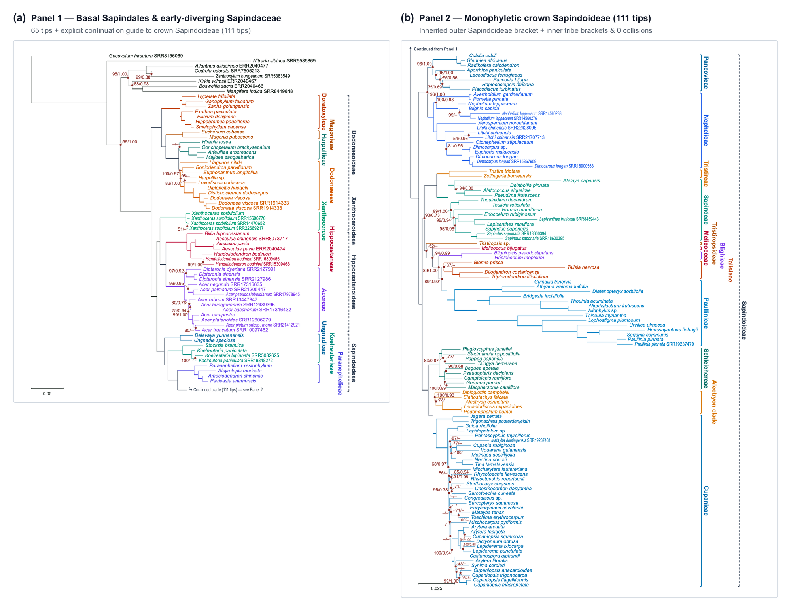
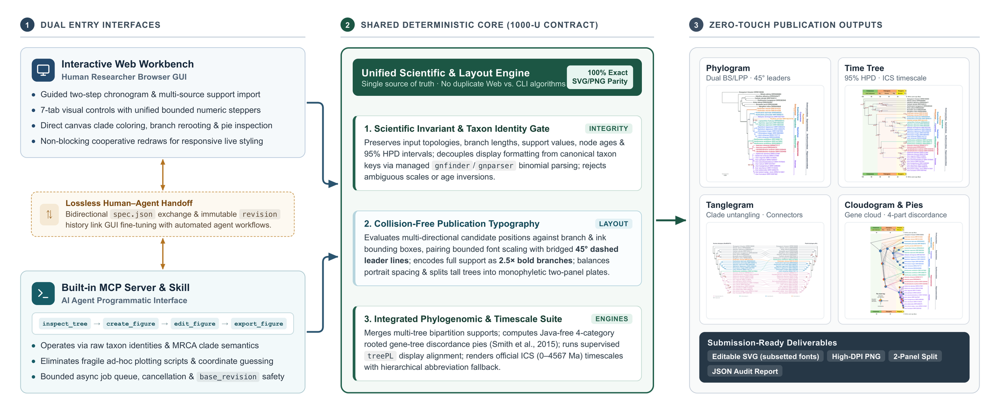

# PhyloRender

**English** | [简体中文](README.zh-CN.md)

**An interactive and agent-ready package for reproducible phylogenetic visualization**

> **Documentation & Manuals**: [User Manual & Full Parameter Reference](docs/USER_MANUAL.md) ([中文说明书](docs/USER_MANUAL.zh-CN.md)) · [Quick Walkthrough](docs/USER_GUIDE.md) ([中文导览](docs/USER_GUIDE.zh-CN.md)) · [Algorithms & Architecture](docs/ALGORITHMS_AND_ARCHITECTURE.md) ([中文算法推导](docs/ALGORITHMS_AND_ARCHITECTURE.zh-CN.md)) · [MCP Server Guide](mcp-server/README.md) · [Agent Skill Guide](skills/phylorender-mcp/README.md)



---

## Why PhyloRender?

Scientific workflows are rapidly entering the AI agent era, where coding and research agents already automate many multi-step analyses and standard statistical plots. Turning raw phylogenetic trees into submission-ready manuscript figures, however, still requires heavy manual work due to three everyday bottlenecks:

1. **No native interface for AI agents**: Existing tree viewers rely on manual mouse clicks, whereas general scripting libraries force AI agents to write ad-hoc R or Python code from scratch with no structured way to verify taxon identities or detect overlapping labels.
2. **Fragmented tools across standard phylogenomic figures**: A typical evolutionary study needs multi-support phylograms, fossil-calibrated chronograms, cytonuclear tanglegrams, and multi-locus cloudograms with discordance pie charts—forcing researchers to convert files repeatedly across a dozen separate viewers, scripts, Java utilities, and C++ binaries.
3. **The "last-mile" vector-editing bottleneck**: On rapid radiations and short internal branches, raw plots stack support numbers over branches, fail to align nested taxonomic brackets, and require manual assembly of geologic timescales—costing hours of non-reproducible cleanup in Adobe Illustrator, CorelDRAW, or Inkscape whenever an upstream analysis changes.

**PhyloRender addresses all three bottlenecks in a single open-source package.** Built on one deterministic layout and data-integrity engine, it combines an interactive **Browser Workbench**, a built-in **Model Context Protocol (MCP) server**, and a domain **Agent Skill** across all four core phylogenomic figure types—exporting publication-ready vector SVGs, high-DPI PNGs, and two-panel splits directly from Newick and Nexus files.

---

## Visual Gallery & Empirical Examples

All empirical examples below are exported directly from PhyloRender without any post-processing in external vector graphics editors (datasets from Sapindaceae phylogenomics, He et al., 2025).

### 1. Interactive Web Workbench & Rapid-Radiation Label Placement

On dense, short-branch radiations, standard scripting libraries either print overlapping composite supports over branches or distort true branch lengths. PhyloRender keeps original branch lengths intact, encodes full-support backbones as thickened branches, and places crowded support labels into open whitespace with clean leader lines.



* **(a)** Interactive PhyloRender Browser Workbench with unified `− / number / +` numeric steppers, live canvas clade selection, and one-click label placement optimization.
* **(b–d)** Unedited outputs on the same 50-taxon Sapindoideae rapid radiation pairing ML bootstrap (`%`) and ASTRAL posterior (`0–1`) supports: **(b)** R `ape`, **(c)** Python `ETE3` (`position="float"`), and **(d)** **PhyloRender** (zero label overlaps).

---

### 2. Phylogram, Fossil-Calibrated Chronogram & Cytonuclear Tanglegram

PhyloRender unifies everyday manuscript trees under consistent typography, taxonomic italicization, and color palettes:



* **(a) Multi-Support Phylogram (`phylogeny`)**: Automatically pairs branches across unrooted or differently rooted trees (e.g., ML bootstrap + ASTRAL LPP) via canonical bipartition splits, with strictly aligned two-tier tribe (solid) and subfamily (dashed) brackets.
* **(b) Calibrated Chronogram (`time`)**: Preserves supplied root and divergence ages, renders 95% HPD credible bars against an official International Commission on Stratigraphy (ICS) geologic timescale with adaptive narrow-cell label fitting, and omits support numbers so chronological intervals stay unambiguous.
* **(c) Cytonuclear Tanglegram (`conflict`)**: Matches raw taxon identifiers one-to-one between nuclear and plastid/mitochondrial trees and untangles crossing connectors via sister-clade rotation without altering either tree's topology.

---

### 3. Gene-Tree Cloudogram & Four-Category Discordance Pies (Zero Java / C++ Setup)

Assembling a cloudogram with conflict pie charts traditionally requires installing Java (`PhyParts`) and C++ (`treePL` + `ADOL-C` + `NLopt`). PhyloRender includes built-in pure JavaScript implementations of both calculations so cloudograms run out of the box across macOS, Linux, and Windows:



* **Built-in four-category discordance module**: Follows Smith et al. (2015) to count concordant, dominant alternative, remaining alternative, and uninformative gene trees (including partial-taxon gene trees) independently of input tree order.
* **Built-in penalized-likelihood visual scaling module**: Follows Sanderson (2002) and Smith & O'Meara (2012) to scale complete-taxon ML gene trees smoothly onto shared species-tree clade ages for visual overlay (`display_alignment`), anchoring shared nodes vertically and coloring gene branches by species-tree MRCA.

---

### 4. Automated Monophyletic Two-Panel Split for Large Trees

Tall phylogenies (e.g., 150–300+ tips) can be split automatically at a monophyletic crown clade into two equal-width panels while carrying spanning outer clade brackets cleanly across both panels:



---

### 5. Unified Human & AI Agent Architecture

Both the browser GUI and programmatic MCP tools execute the exact same parsing, validation, and rendering modules on a canonical `1,000-u` coordinate system, allowing seamless handoff via portable `.json` figure specifications and immutable revisions:



---

## Summary of the Four Workspaces

| Workspace | MCP `workspace` | Key Capabilities & Built-in Data Safeguards |
| --- | --- | --- |
| **Phylogram** | `phylogeny` | Single or multi-tree bipartition-matched supports (`%` and `0–1`), thickened full-support branches, low-support masking (`–`), leader-line collision avoidance, multi-tier clade brackets, and two-panel splitting. |
| **Time Tree** | `time` | Two-step guided import (tree + time unit & age source), 95% HPD bars, official ICS geologic bands, and two-panel splitting. Preserves input root and chronology; blocks rerooting and support overlays. |
| **Cloudogram & Discordance** | `cloud` | Dated species tree + multi-locus ML gene trees, built-in JS penalized-likelihood visual branch scaling, built-in JS 4-category conflict pies, MRCA branch coloring, and ICS timescale bands. |
| **Tanglegram** | `conflict` | Side-by-side two-tree comparison, strict 1-to-1 raw identity matching, explicit `intersection`/`union` mismatch handling, and sister-clade untangling. |

---

## Quick Start

### Prerequisites

- **Python 3.9+** (for the local loopback Web Workbench server)
- **Node.js 20+** and **Google Chrome / Chromium** (for the MCP server and Agent Skill; Playwright can install Chromium automatically if needed)

```bash
git clone https://github.com/Jhe1004/PhyloRender.git
cd PhyloRender
```

### 1. Interactive Web Workbench (Browser GUI)

Start the local loopback server from the repository root:

```bash
python3 tools/local_server.py --host 127.0.0.1 --port 8765 --open
```

- On **macOS**, you can also double-click `start_phylorender.command`.
- The workbench opens empty by default. To explore built-in public demonstration datasets right away:
  - Phylogram demo: `http://127.0.0.1:8765/?demo=1&workspace=phylogeny`
  - Time Tree demo: `http://127.0.0.1:8765/?demo=1&workspace=time`
  - Cloudogram demo: `http://127.0.0.1:8765/?demo=1&workspace=cloud`
  - Tanglegram demo: `http://127.0.0.1:8765/?demo=1&workspace=conflict`
- Export editable SVGs, high-DPI PNGs, two-panel `.zip` bundles, or portable `.json` figure specs from the **Export** tab.

### 2. MCP Server (AI Agents & Programmatic Workflows)

Install MCP server dependencies once:

```bash
npm ci --prefix mcp-server
# Optional if Chrome/Chromium is not already installed on your machine:
npm --prefix mcp-server run install-browser
```

#### Option A: Local `stdio` MCP (Claude Desktop, Cursor, Windsurf, Codex, Antigravity)

Add to your MCP client configuration (replace `/absolute/path/to/PhyloRender` with your local clone path):

```json
{
  "mcpServers": {
    "phylorender": {
      "command": "node",
      "args": ["/absolute/path/to/PhyloRender/mcp-server/src/stdio.mjs"]
    }
  }
}
```

#### Option B: Local Streamable HTTP MCP

```bash
npm --prefix mcp-server run start:http
```

- MCP endpoint: `http://127.0.0.1:8766/mcp`
- Health check: `http://127.0.0.1:8766/health`

#### Option C: Docker Container (Linux / Lab Server)

```bash
docker build -f mcp-server/Dockerfile -t phylorender-mcp .
docker run --rm --init -p 127.0.0.1:8766:8766 \
  -e PHYLORENDER_MCP_TOKEN='replace-with-a-long-random-token' \
  -e PHYLORENDER_ALLOWED_HOSTS='localhost,127.0.0.1' \
  phylorender-mcp
```

### 3. Companion Agent Skill (`skills/phylorender-mcp/`)

PhyloRender ships a ready-to-install **Agent Skill** in [`skills/phylorender-mcp/`](skills/phylorender-mcp/) for AI coding assistants (Codex, Antigravity, Claude Code, Cursor, etc.). It equips agents with local-first MCP job orchestration, domain plotting safeguards (confirming outgroups before rerooting undated trees, checking taxon overlap on tanglegrams, and verifying zero collisions), and fast vector-first output.

```bash
# 1. Copy the skill folder into your assistant's skill directory
cp -R skills/phylorender-mcp ~/.codex/skills/phylorender-mcp
# (Or for Antigravity / Gemini CLI: cp -R skills/phylorender-mcp ~/.gemini/config/skills/phylorender-mcp)

# 2. Point local-config.json to your cloned PhyloRender repository
cp skills/phylorender-mcp/local-config.example.json ~/.codex/skills/phylorender-mcp/local-config.json
# Edit "repoRoot" inside local-config.json to your absolute PhyloRender path

# 3. Verify health and available MCP tools
node ~/.codex/skills/phylorender-mcp/scripts/phylorender_mcp_client.mjs health
node ~/.codex/skills/phylorender-mcp/scripts/phylorender_mcp_client.mjs tools
```

Once installed, simply prompt your AI assistant in plain language:
> *"Using `ml.treefile` as the main tree and `astral.tre` as an auxiliary support tree, draw a Phylogram rooted on `Dipteronia_sinensis`, add inner solid tribe brackets and outer dashed subfamily brackets, and export SVG and 600-DPI PNG."*

---

## Complete Documentation & Manuals

| Document | English | 简体中文 | Contents |
| --- | --- | --- | --- |
| **Repository Overview** | [README.md](README.md) | [README.zh-CN.md](README.zh-CN.md) | Visual gallery, workspace summary & quick start |
| **User Manual & Parameter Reference** | [docs/USER_MANUAL.md](docs/USER_MANUAL.md) | [docs/USER_MANUAL.zh-CN.md](docs/USER_MANUAL.zh-CN.md) | Full option tables mapping Web UI ↔ MCP fields ↔ Agent Skill prompts, all 15 MCP tools & step-by-step workflows |
| **Quick Walkthrough Guide** | [docs/USER_GUIDE.md](docs/USER_GUIDE.md) | [docs/USER_GUIDE.zh-CN.md](docs/USER_GUIDE.zh-CN.md) | Concise feature tour & troubleshooting FAQ |
| **Algorithms & Architecture Reference** | [docs/ALGORITHMS_AND_ARCHITECTURE.md](docs/ALGORITHMS_AND_ARCHITECTURE.md) | [docs/ALGORITHMS_AND_ARCHITECTURE.zh-CN.md](docs/ALGORITHMS_AND_ARCHITECTURE.zh-CN.md) | Mathematical formulations for split matching, label routing, multi-tier brackets, JS conflict/PL solvers & transactional runtime |
| **MCP Server Guide** | [mcp-server/README.md](mcp-server/README.md) | [mcp-server/README.zh-CN.md](mcp-server/README.zh-CN.md) | Transport modes, environment variables, security & Docker deployment |
| **Agent Skill Guide** | [skills/phylorender-mcp/README.md](skills/phylorender-mcp/README.md) | [skills/phylorender-mcp/README.zh-CN.md](skills/phylorender-mcp/README.zh-CN.md) | Skill setup, CLI helper usage & prompt templates |
| **MCP Schema & Unit Contract** | [mcp-server/docs/agent-guide.md](mcp-server/docs/agent-guide.md) | [mcp-server/docs/physical-units.md](mcp-server/docs/physical-units.md) | Canonical `1000-u` coordinate contract & JSON schemas |
| **Benchmark & Evaluation Suite** | [evaluation/README.md](evaluation/README.md) | — | Reproducible verification and benchmark scripts |

---

## Verification & Automated Tests

Run the project-wide unit, schema, manifest, and release-compliance checks from the repository root:

```bash
node tools/build-manifest.cjs
node tools/check-project.cjs
node tools/check-release.cjs
node --test skills/phylorender-mcp/scripts/local_service.test.mjs
```

Run end-to-end headless browser and MCP transport smoke tests:

```bash
(cd mcp-server && node tests/mcp-smoke.mjs && node tests/http-smoke.mjs)
```

---

## License & Citation

- **License**: Original source code is licensed under **GPL-3.0-or-later** ([LICENSE](LICENSE)). Third-party components, bundled fonts, and public demonstration datasets retain their respective licenses ([THIRD_PARTY_NOTICES.md](THIRD_PARTY_NOTICES.md), [defaults/README.md](defaults/README.md)).
- **Citation**: If you use PhyloRender in your research, please cite ([CITATION.cff](CITATION.cff)):
  > He, J., Chen, J., He, Z., Xiao, J., & Xie, L. (2026). *PhyloRender: an interactive and agent-ready package for reproducible phylogenetic visualization*. bioRxiv.
