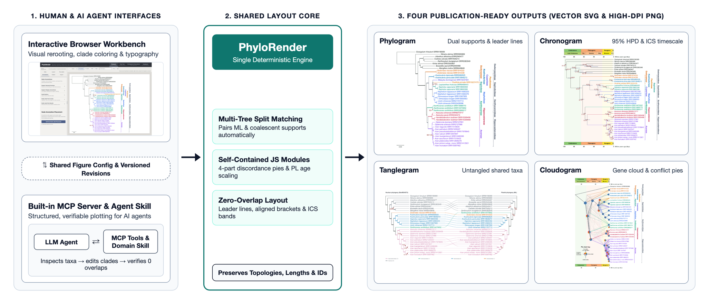
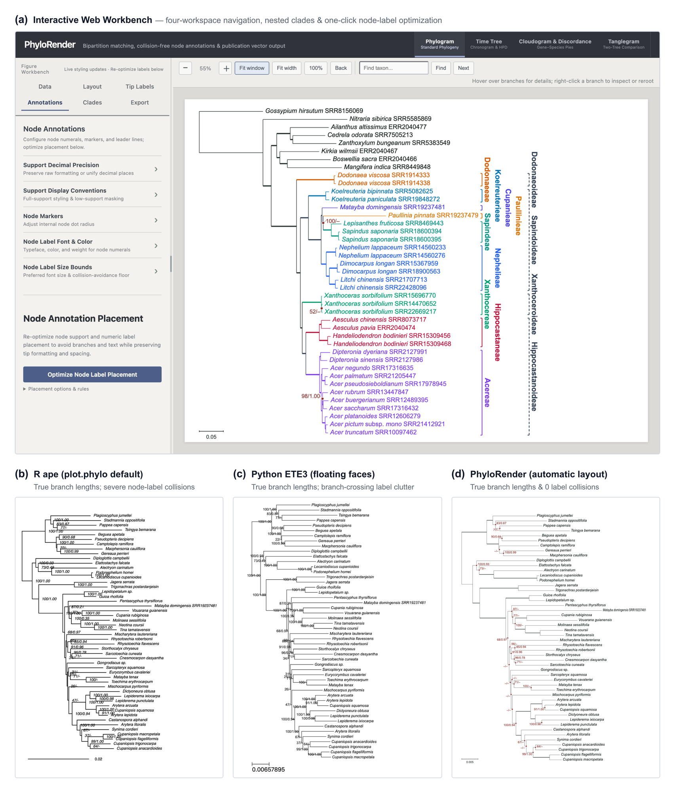
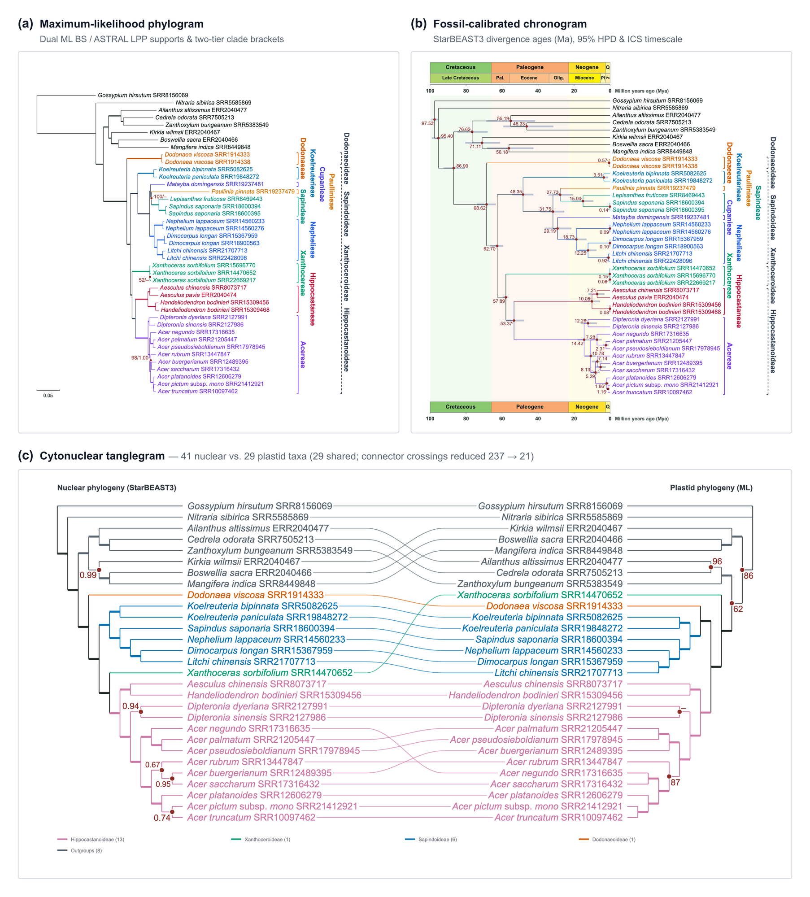
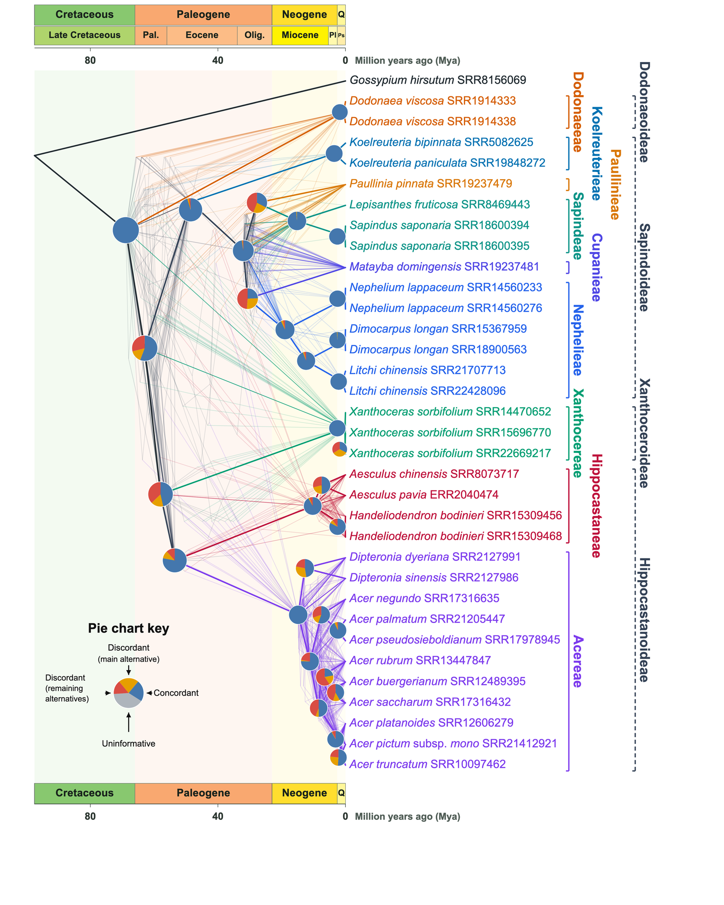
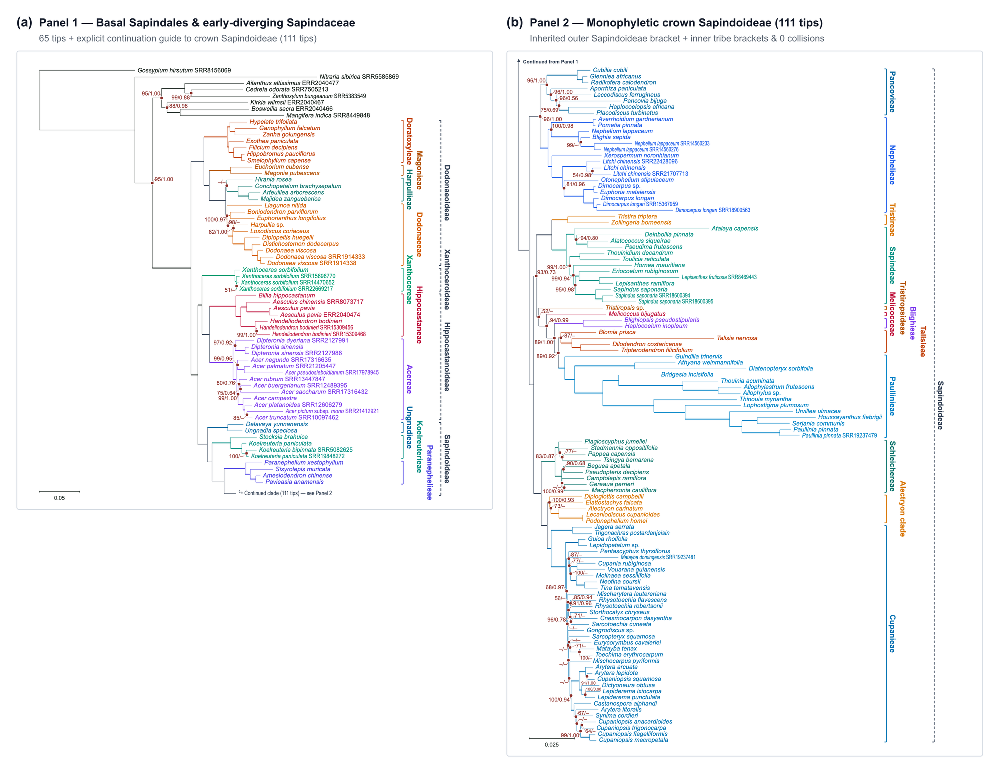
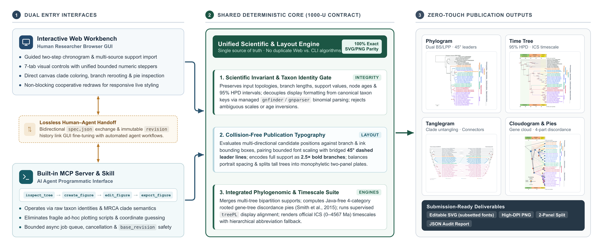

# PhyloRender

[English](README.md) | **简体中文**

**面向人类研究者与 AI Agent 的交互式可复现系统发育可视化软件包**

> **完整说明书与技术文档导航**：[完整使用说明书与全参数总表](docs/USER_MANUAL.zh-CN.md) ([English Manual](docs/USER_MANUAL.md)) · [快速功能导览](docs/USER_GUIDE.zh-CN.md) ([English Guide](docs/USER_GUIDE.md)) · [核心算法推导与系统架构](docs/ALGORITHMS_AND_ARCHITECTURE.zh-CN.md) ([Algorithms & Architecture](docs/ALGORITHMS_AND_ARCHITECTURE.md)) · [MCP 服务手册](mcp-server/README.zh-CN.md) · [Agent Skill 指南](skills/phylorender-mcp/README.zh-CN.md)



---

## 为什么需要 PhyloRender？

当前科学研究正加速进入 AI agent 时代，许多多步骤的数据分析与常规统计绘图已能由 AI 助手自动完成。然而，把建树软件输出的原始树文件变成可直接投稿发表的期刊成图，仍然高度依赖繁琐的人工修图，主要受制于三大日常痛点：

1. **缺乏面向 AI Agent 的原生接口**：现有图形界面看树软件依赖鼠标点击，而通用绘图代码库迫使 AI 从零编写一次性 R/Python 脚本，既没有结构化工具校验样品身份与外群，也无法自动检测图面文字是否重叠。
2. **四类标准系统发育图件分散在十余种互不兼容的工具中**：一篇完整的系统发育基因组学论文往往同时需要多支持率常规树（Phylogram）、化石校准分子钟时间树（Chronogram）、核质冲突双树对照图（Tanglegram）以及多位点基因树冲突云图与饼图（Cloudogram & Pies），迫使作者在十几种独立脚本、网页工具、Java 程序与 C++ 编译依赖之间反复转换格式。
3. **“最后一公里”矢量手工修图难题**：在快速辐射演化支和密集短枝区域，传统软件导出的初稿普遍存在支持率与树枝重叠、多层分类群括号不对齐、地质年代表需手动拼画等问题，导致作者每次更新上游结果都要在 Adobe Illustrator、CorelDRAW 或 Inkscape 中耗费数小时手动挪字修图，难以自动复现。

**PhyloRender 在单一开源软件包中同时解决了这三大痛点。** 基于同一套确定性排版与数据完整性校验引擎，PhyloRender 将交互式 **浏览器工作台（Web Workbench）**、内置 **MCP（Model Context Protocol）服务**与领域 **Agent Skill** 融为一体，一站式覆盖全部四类核心系统发育图件，直接从 Newick 和 Nexus 树文件输出无需手工修图的出版级矢量 SVG、高分辨率 PNG 与单系双面板大图。

---

## 实证案例与功能展示图库

以下所有实证图件均由 PhyloRender 直接导出，**未经任何外部矢量绘图软件手工调整**（实证数据来自已发表无患子科系统发育基因组数据集，He et al., 2025）。

### 1. 交互式 Web 工作台与快速辐射短枝排布对比

在内部短枝密集的快速辐射演化支上，传统脚本库要么导致复合支持率严重叠字，要么为塞下文字而篡改真实枝长。PhyloRender 严格保留原始枝长与拓扑，将双满支持主干编码为加粗树枝，并通过引线将拥挤支持率自动排入周边留白区，实现零重叠：



* **(a)** PhyloRender 交互式浏览器工作台：统一的 `− / 数字输入 / +` 精确步进器、画布直接点击建组/重定根，以及底部一键节点标注自动避让按钮。
* **(b–d)** 同一棵 50 物种无患子亚科快速辐射演化支（配对 ML 自展值 `%` 与 ASTRAL 后验概率 `0–1`）的无手工修图直出对比：**(b)** R `ape`、**(c)** Python `ETE3`（`position="float"`）与 **(d)** **PhyloRender**（零标签重叠）。

---

### 2. 多源支持率常规树、分子钟时间树与核质冲突双树对照图

在同一套字体规范、拉丁学名斜体规则与分类群配色方案下协同生成整篇论文的核心树图：



* **(a) 多方法合并常规树（`phylogeny`）**：按无根二分划分（canonical unrooted splits）自动配对不同建树软件的相同演化支（如拼接法 ML 自展值 + ASTRAL 溯祖后验概率），右侧自动排布严格同列对齐的内层实线“族”括号与外层虚线“亚科”括号。
* **(b) 化石校准分子钟时间树（`time`）**：严格保留输入树根、分化年龄与 95% HPD 置信区间条，自动屏蔽支持率以免与年代混淆，并绘制官方国际地层委员会（ICS）地质年代表（窄年代格自动缩字适配，绝不越界重叠）。
* **(c) 核质冲突双树对照图（`conflict`）**：基于原始样品编号执行严格 1 对 1 对齐，仅通过旋转姐妹分支大幅减少核质拓扑冲突连线的无谓交叉，丝毫不改变任一棵树的拓扑结构。

---

### 3. 基因树冲突云图与四分类冲突饼图（零 Java / C++ 外部安装依赖）

传统流程制作“云树 + 基因树冲突饼图”需要分别配置 Java 环境（`PhyParts`）并编译复杂的 C++ 数学库（`treePL` + `ADOL-C` + `NLopt`）。PhyloRender 用纯 JavaScript 内置实现了这两套核心计算模块，在 macOS、Linux 与 Windows 上开箱即用：



* **内置无 Java 四分类冲突统计模块**：依据 Smith et al. (2015) 有根二分对比规则，自动统计一致（Concordant）、主次冲突（Main alternative）、其余冲突（Remaining alternatives）与无信息（Uninformative）四类基因树比例（兼容缺失部分物种的基因树，且统计结果与输入树顺序完全无关）。
* **内置无 C++ 惩罚似然视觉缩放模块**：依据 Sanderson (2002) 与 Smith & O'Meara (2012) 的速率平滑惩罚似然方法，在锁定物种树共有演化支年龄的前提下将完整取样 ML 基因树平滑缩放至同一地质时间轴供视觉叠绘（在报告中明确标注 `display_alignment`），共有内部节点纵向锚定对齐，基因枝按物种树 MRCA 自动着色。

---

### 4. 大型系统发育树自动单系双面板切分

面对单页难以容纳的大型系统发育树（如 150–300+ 样品），PhyloRender 支持在单系冠群处自动切分为两张等宽面板，并将跨面板的外层亚科括号自动延续至第二面板：



---

### 5. 人类研究者与 AI Agent 共享同一渲染引擎

浏览器工作台与内置 MCP 服务 + Agent Skill 底层运行完全相同的树解析、数据保护与几何排版引擎（统一 `1,000-u` 画布坐标契约），支持通过 `.json` 配置文件与不可变修订号（`revision`）在人工微调与 AI 批量自动化之间无损接力：



---

## 四大工作区能力速查

| 工作区名称 | MCP `workspace` | 核心适用场景与内置科学数据保护 |
| --- | --- | --- |
| **普通系统发育树（Phylogram）** | `phylogeny` | 单树或多树无根二分匹配支持率（`%` 与 `0–1`）、满支持加粗枝、低支持掩码（`–`）、引线防重叠排布、多层共线分类括号、单系双面板导出。 |
| **分化时间树（Time Tree）** | `time` | 两步引导导入（导树 + 确认时间单位与年龄来源）、95% HPD 误差条、官方 ICS 地质年代表、双面板导出。严格保留原根与原年代，主动屏蔽重定根与支持率叠加。 |
| **基因树冲突云图（Cloudogram）** | `cloud` | 已定年物种树 + 批量 ML 基因树、内置 JS 惩罚似然视觉对齐、内置 JS 四分类冲突饼图、物种树 MRCA 分支着色、ICS 地质时间轴。 |
| **双树冲突对照图（Tanglegram）** | `conflict` | 双树并排拓扑比较、严格 1 对 1 原始样品身份匹配、样品差异显式 `intersection`/`union` 确认、姐妹分支旋转自动解缠。 |

---

## 快速上手（Quick Start）

### 环境要求

- **Python 3.9+**（启动本机回环 Web 工作台服务）
- **Node.js 20+** 与 **Google Chrome / Chromium**（运行 MCP 服务与 Agent Skill；若未安装浏览器可通过 Playwright 一键安装）

```bash
git clone https://github.com/Jhe1004/PhyloRender.git
cd PhyloRender
```

### 1. 交互式 Web 工作台（人工浏览器操作）

在仓库根目录执行一条命令即可启动并自动打开浏览器：

```bash
python3 tools/local_server.py --host 127.0.0.1 --port 8765 --open
```

- **macOS 用户**也可直接双击仓库根目录下的 `start_phylorender.command`。
- 默认打开为空白画布；如需直接使用内置公开示例数据体验四大工作区，可访问：
  - 普通系统发育树示例：`http://127.0.0.1:8765/?demo=1&workspace=phylogeny`
  - 分化时间树示例：`http://127.0.0.1:8765/?demo=1&workspace=time`
  - 冲突云图示例：`http://127.0.0.1:8765/?demo=1&workspace=cloud`
  - 双树对照示例：`http://127.0.0.1:8765/?demo=1&workspace=conflict`
- 在左侧 **Export** 标签页可一键导出可编辑矢量 SVG、高 DPI PNG、双面板 `.zip` 压缩包或完整配置文件 `.json`。

### 2. MCP 服务（AI Agent 接入与程序化制图）

首次使用先安装一次 MCP 依赖：

```bash
npm ci --prefix mcp-server
# 如本机尚未安装 Chrome/Chromium，可执行：
npm --prefix mcp-server run install-browser
```

#### 方式 A：本地 `stdio` 模式（适用于 Claude Desktop、Cursor、Windsurf、Codex、Antigravity）

在客户端 MCP 配置中添加（将 `/absolute/path/to/PhyloRender` 替换为本机克隆路径）：

```json
{
  "mcpServers": {
    "phylorender": {
      "command": "node",
      "args": ["/absolute/path/to/PhyloRender/mcp-server/src/stdio.mjs"]
    }
  }
}
```

#### 方式 B：本地 Streamable HTTP 模式

```bash
npm --prefix mcp-server run start:http
```

- MCP 端点：`http://127.0.0.1:8766/mcp`
- 健康检查：`http://127.0.0.1:8766/health`

#### 方式 C：Docker 容器部署（Linux / 课题组服务器）

```bash
docker build -f mcp-server/Dockerfile -t phylorender-mcp .
docker run --rm --init -p 127.0.0.1:8766:8766 \
  -e PHYLORENDER_MCP_TOKEN='replace-with-a-long-random-token' \
  -e PHYLORENDER_ALLOWED_HOSTS='localhost,127.0.0.1' \
  phylorender-mcp
```

### 3. 配套 Agent Skill（`skills/phylorender-mcp/`）

仓库在 [`skills/phylorender-mcp/`](skills/phylorender-mcp/) 中内置了开箱即用的 **Agent Skill**，支持 Codex、Antigravity、Claude Code、Cursor 等主流 AI 编程助手。启用后，AI 会自动遵循系统发育制图规范（未定年树先确认外群、双树先核查样品交并集、大树自动走异步任务队列、导出前校验零碰撞报告）：

```bash
# 1. 将 Skill 复制到你的 AI 助手技能目录
cp -R skills/phylorender-mcp ~/.codex/skills/phylorender-mcp
# （Antigravity / Gemini CLI 用户：cp -R skills/phylorender-mcp ~/.gemini/config/skills/phylorender-mcp）

# 2. 复制本地路径配置模板并填入你本机的 PhyloRender 仓库绝对路径
cp skills/phylorender-mcp/local-config.example.json ~/.codex/skills/phylorender-mcp/local-config.json

# 3. 验证本地 MCP 连接与全部 15 个工具发现
node ~/.codex/skills/phylorender-mcp/scripts/phylorender_mcp_client.mjs health
node ~/.codex/skills/phylorender-mcp/scripts/phylorender_mcp_client.mjs tools
```

配置完成后即可直接用自然语言让 AI 制图：
> *“以 `ml.treefile` 为主树、`astral.tre` 为附加支持率树，以 `Dipteronia_sinensis` 为外群画一棵系统发育树，加上内层实线族括号和外层虚线亚科括号，导出 SVG 和 600 DPI 的 PNG。”*

---

## 完整说明书与技术文档索引

| 文档名称 | 简体中文 | English | 主要内容说明 |
| --- | --- | --- | --- |
| **仓库主页总览** | [README.zh-CN.md](README.zh-CN.md) | [README.md](README.md) | 实证图库展示、四大工作区概览与快速启动 |
| **完整使用说明书与参数总表** | [docs/USER_MANUAL.zh-CN.md](docs/USER_MANUAL.zh-CN.md) | [docs/USER_MANUAL.md](docs/USER_MANUAL.md) | Web 界面 ↔ MCP 字段 ↔ Agent Skill 口令三端全参数对照大表、15 个 MCP 工具清单、五大安全门禁与分步实操流程 |
| **快速功能导览与常见问题** | [docs/USER_GUIDE.zh-CN.md](docs/USER_GUIDE.zh-CN.md) | [docs/USER_GUIDE.md](docs/USER_GUIDE.md) | 核心功能速览与常见故障排查（FAQ） |
| **核心算法推导与系统架构** | [docs/ALGORITHMS_AND_ARCHITECTURE.zh-CN.md](docs/ALGORITHMS_AND_ARCHITECTURE.zh-CN.md) | [docs/ALGORITHMS_AND_ARCHITECTURE.md](docs/ALGORITHMS_AND_ARCHITECTURE.md) | 无根二分匹配、Liang–Barsky 碰撞过滤与引线代价函数、多层共线括号、JS 冲突与惩罚似然求解器完整数学公式及事务一致性架构 |
| **MCP 服务部署与 API 手册** | [mcp-server/README.zh-CN.md](mcp-server/README.zh-CN.md) | [mcp-server/README.md](mcp-server/README.md) | 传输协议、环境变量、鉴权安全与 Docker 部署说明 |
| **Agent Skill 安装与实战手册** | [skills/phylorender-mcp/README.zh-CN.md](skills/phylorender-mcp/README.zh-CN.md) | [skills/phylorender-mcp/README.md](skills/phylorender-mcp/README.md) | Skill 安装配置、CLI 客户端脚本与常用提示词模板 |
| **MCP 单位契约与协议规范** | — | [agent-guide.md](mcp-server/docs/agent-guide.md) · [physical-units.md](mcp-server/docs/physical-units.md) | `1000-u` 绘图单位换算契约与 JSON Schema 说明 |
| **自动化基准评测包** | — | [evaluation/README.md](evaluation/README.md) | 可复现工程验证与性能评测套件 |

---

## 自动化验证与测试

在仓库根目录执行完整单元测试、模块边界检查、Schema 核验与开源合规检查：

```bash
node tools/build-manifest.cjs
node tools/check-project.cjs
node tools/check-release.cjs
node --test skills/phylorender-mcp/scripts/local_service.test.mjs
```

运行真实无头浏览器与 MCP 协议端到端冒烟测试：

```bash
(cd mcp-server && node tests/mcp-smoke.mjs && node tests/http-smoke.mjs)
```

---

## 开源协议与论文引用

- **开源协议**：PhyloRender 原始源代码采用 **GPL-3.0-or-later** 协议发布（见 [LICENSE](LICENSE)）；第三方组件、内置开源字体及公开演示数据保留各自原始许可声明（见 [THIRD_PARTY_NOTICES.md](THIRD_PARTY_NOTICES.md) 与 [defaults/README.md](defaults/README.md)）。
- **论文引用**：如在研究中使用了 PhyloRender，请引用（元数据见 [CITATION.cff](CITATION.cff)）：
  > He, J., Chen, J., He, Z., Xiao, J., & Xie, L. (2026). *PhyloRender: an interactive and agent-ready package for reproducible phylogenetic visualization*. bioRxiv.
